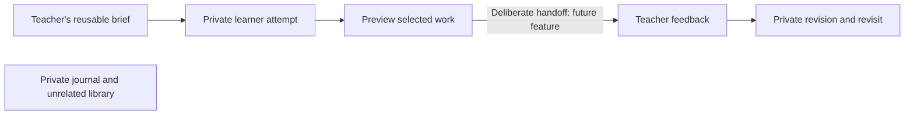

# Library engine, security and teacher–student development brief

Research date: 18 October 2026. This document preserves the original research,
design proposals and acceptance criteria from the research pass. The subsequent
local increment implements versioned briefs, private attempts, selected text
handoff and bound feedback in an optional education adapter. See
[the current workflow and protection guide](EDUCATION.md),
[architecture](ARCHITECTURE.md) and [verification record](VERIFICATION.md) for
implementation status and evidence. The generic library engine remains
independent of the education interface and hosting provider.

A small [DCMI-term mapping](DCMI.md) is also now available for explicitly selected
resource metadata. The interoperability proposal below remains historical;
this helper does not establish a full application profile or RDF conformance.

The original baseline and prospective language below are historical context,
not a claim that the implemented local workflow is a hosted classroom. No fresh
source security audit, institutional pilot or legal clearance is established by
this research. Optional server policy/abuse references are described in
[their own contract](CLASSROOM-AUTHORIZATION.md); no hosted enforcement is active.

## Recommended direction

Help a teacher and learner complete one useful cycle:
**clear goal → private attempt → selected question → feedback → revision → revisit**.
The teacher supplies context and useful direction; the learner controls which
work is submitted. Private reading and journals are not the price of getting help.

Start with a reusable learning brief and a private attempt. Introduce selective
handoff only after its data boundary is tested. Hosted classrooms, rosters,
gradebooks, real-time chat and AI grading are separate future decisions.

## Baseline at the start of the research pass

[Architecture](ARCHITECTURE.md), [security policy](../SECURITY.md),
[format](FORMAT.md), [draft behavior](DRAFTS.md) and [capacity research](CAPACITY.md)
describe a portable catalog, encrypted snapshots, bounded imports, conditional
storage writes, locking and local learning suggestions. The passphrase gate is
not a school account, a teacher identity or course authorization. There is no
implemented classroom permission model.

These are documented capabilities and limits, not newly audited source findings.
The 16 October record contains 82 unit and 199 browser/accessibility passes;
those results were not rerun for this documentation-only research pass. Neither
those tests nor this brief establish physical-device, classroom or legal safety.

## Research translated into decisions

| Evidence | Design decision and limit |
| --- | --- |
| [IES/WWC study guidance](https://ies.ed.gov/ncee/wwc/PracticeGuide/1) distinguishes stronger support for recall/re-exposure and explanatory questions from moderate support for spacing and worked-example alternation. | Offer an attempt before revealing an example, an explanation prompt and an editable revisit date. Do not claim one optimal schedule or that these features prove learning. |
| [EEF feedback guidance](https://educationendowmentfoundation.org.uk/education-evidence/guidance-reports/feedback) emphasizes useful feedback principles, learning intentions and an opportunity to act. | Give the teacher a small observation/next-action field and the learner a revision step. Do not turn a comment inbox into a measure of teaching quality. |
| [EEF metacognition guidance, second edition 2025](https://educationendowmentfoundation.org.uk/education-evidence/guidance-reports/metacognition) connects explicit modelling and scaffolding to subject content. | Use optional, editable planning/checking/reflection prompts within the task. A generic journal or inferred confidence score is not a validated metacognition intervention. |
| [UNESCO/Teacher Task Force teacher-agency paper, 2025](https://www.teachertaskforce.org/sites/default/files/2025-09/1149_25_Promoting%20and%20Protecting%20Teacher%20Agency_FINAL_3Sep.pdf) is policy guidance about professional judgment, not an efficacy trial. | Teachers can edit or reject suggestions. Completion is learner-marked completion, not an automatic mastery, diligence or ability label. No AI is required for the proposed cycle. |
| [UNESCO OER Recommendation](https://www.unesco.org/en/legal-affairs/recommendation-open-educational-resources-oer) distinguishes open licensing from merely free access and supports accessible/adaptable resources. | Preserve creator, source, license, language and adaptation credit. Unknown permission stays unknown. Software's MIT license does not license imported content. |
| [WCAG 2.2](https://www.w3.org/TR/WCAG22/) provides accessibility requirements; [UNESCO distance-learning guidance](https://www.unesco.org/en/digital-education/distance-learning-guidance) addresses access constraints. | Make a text-first task usable without media, with keyboard access, reflow and alternatives. Use 44px controls as a convenience goal; AA's 24px target criterion has exceptions. Do not promise offline cold starts or full conformance before testing. |

These sources support instructional and design choices. They do not establish
this application's educational outcomes, safety or suitability for every age,
subject, disability, language or institution. Review-date convenience is useful
without claiming an optimized memory algorithm.

Recent counterevidence also matters. A [2025 high-school mathematics randomized trial](https://doi.org/10.1073/pnas.2422633122)
found that unrestricted GPT assistance improved assisted practice while reducing
subsequent unassisted performance. Its guarded tutor avoided that observed loss,
without establishing an unassisted advantage over the control. This is evidence
from a particular setting, not a conclusion that all AI tutoring helps or harms.
It supports testing independent attempts and later work, rather than treating
polished assisted answers as proof of learning. The publisher's
[2025 correction](https://doi.org/10.1073/pnas.2518204122) concerns an affiliation.
Any future AI feature needs separate educational/privacy validation.

## One original workflow

A teacher creates a physics brief with a learning goal, one teacher-created or appropriately licensed example,
source references, one practice task and a success checklist. A learner makes a
personal copy, hides the example and tries the task. Their exploratory notes
remain private.

When handoff is implemented, the learner chooses one attempt and a question,
previews every outgoing field, and deliberately submits it. The teacher returns
one actionable response, such as identifying which step needs another diagram.
The learner revises while retaining the original attempt. Either person can
choose a later review task. Music, language and practical-skill briefs can use
the same cycle without requiring a camera, microphone or remote model.

The unconnected journal is intentional. This is a proposed flow, not an existing
sharing feature. A full-vault backup or vault passphrase must never become a
classroom submission mechanism.

## Minimal architecture for that flow

Keep general catalog/content/backup/storage operations in the engine. Put these
optional records in an education adapter with explicit versioning; do not add
school identities or grading fields to every generic library resource.

| Proposed record | Minimum responsibility |
| --- | --- |
| Learning brief | Goal, selected resource references, model/example, task, success checklist, language and version. No private student content. |
| Attempt snapshot | Brief version, submitted answer/evidence and learner question. Later edits create a revision rather than silently replacing submitted evidence. |
| Feedback | Bound to the intended attempt and audience; observation and next action. An imported `teacher` label is untrusted metadata, not proof of identity. |
| Share preview | An explicit allowlist of included fields/assets and the intended audience. Nothing is sent or exported merely by opening it. |

First prototype the brief and attempt locally, using synthetic data. A subsequent
preview-only prototype should serialize only a selected, permitted subset. Do
not serialize the whole bundle and attempt to hide private fields afterwards.
Unknown extensions are excluded from a sharing profile unless explicitly allowed.
Resolve asset references within that selected subset; unrelated assets and names
must not enter the export through shared identifiers or copied metadata.

Start the handoff prototype with text and source references. File inclusion is
a later boundary: selected assets are transferred verbatim unless a separately
tested transformation is explicitly offered. A PDF/audio file can contain private
annotations, embedded metadata or private content inside its selected bytes.
A field/file manifest does not inspect or sanitize that content. Review it before
sharing; do not claim that an allowlist makes the selected file anonymous.

If file exchange is later enabled, explain whether recipients can read and retain
the file. Nonconfidential teaching material and confidential student submissions
need different handling. Do not invent recipient cryptography. Assess transport,
recipient identity, key distribution/recovery and lost-device behavior before
calling the exchange secure. Downloaded copies cannot reliably be recalled.

## Security work, in priority order

The following are engineering priorities, not validated vulnerabilities.

| Priority | Exposure or limitation | Proposed control and evidence |
| --- | --- | --- |
| P0 | A modified web build, same-origin script or compromised device can expose an unlocked room. Encryption alone cannot remove this boundary. | Review the release/dependency path, private reporting channel, actual served CSP and other applicable headers. Record exact build/source evidence. Test the deployed origin; do not infer headers from example configuration. |
| P0 | Browser eviction, lost passphrases and interrupted saves can prevent recovery. | Add a synthetic restore drill on another browser/device, quota/failure cases, rekey/old-backup checks and honest backup instructions. Do not promise immediate memory erasure or automatic recovery. |
| P0 | Large or hostile imports can consume substantial CPU/memory. | Implement exact UTF-8/base64 size preflight and boundary/property tests before increasing limits. Measure representative browser/device memory and latency. Preserve bounded validation and atomic replacement. |
| P0 before handoff | Accidental export can reveal a private journal, metadata or unrelated files. | Allowlist serializer, exact preview, unique private canaries, cancellation/no-network tests, bounded imports and original-data preservation. Preview/import results must not be interpreted as trust in the author. |
| P1 before hosted classrooms | A signed-in person or a claimed teacher role is not authority over every learner/course. | Server-enforced tenant/course/resource relationships, deny by default, checks on every action and file download, and negative cross-course tests. Browser hiding is not authorization. |
| P1 before shared files | File signatures, hashes and encryption do not show that a document is safe to open. | Layered type/size/content handling, isolated parsing and an assessed scanning/sandbox option. No silent upload of private content to an external scanner. Preserve the existing cautious file-opening boundary. |

[OWASP ASVS 5.0.0](https://owasp.org/projects/asvs) provides versioned verification
requirements; it is a test reference, not an approval badge. Use an applicability
worksheet that records requirement, actual control, test evidence and unresolved
items. Do not invent requirement IDs or declare a whole ASVS level passed.
[NIST SSDF](https://csrc.nist.gov/projects/ssdf) also supports a repeatable development,
release and vulnerability-response process rather than a one-time clean scan.

The key-sharing design should follow established key-lifecycle guidance and retain
defense in depth, not assume ciphertext replaces access controls.
[OWASP cryptographic storage](https://cheatsheetseries.owasp.org/cheatsheets/Cryptographic_Storage_Cheat_Sheet.html)
and [authorization guidance](https://cheatsheetseries.owasp.org/cheatsheets/Authorization_Cheat_Sheet.html)
support those principles. [OWASP file-upload guidance](https://cheatsheetseries.owasp.org/cheatsheets/File_Upload_Cheat_Sheet.html)
supports layered file handling. These references do not certify this project.

## School and minor-user boundaries

The [Philippine Data Privacy Act](https://privacy.gov.ph/data-privacy-act-/)
treats identifiable education information as sensitive personal information.
Removing names or email does not automatically make linked work anonymous.
Operator roles, purposes, lawful processing conditions, recipients and retention
need assessment. [NPC Advisory 2024-03, 17 December 2024](https://privacy.gov.ph/wp-content/uploads/2024/12/Advisory-2024.12.17-Guidelines-on-Child-Oriented-Transparency-w-SGD.pdf)
calls for child-focused impact assessment, privacy defaults and understandable
notices. The education sector's [2020 advisory](https://privacy.gov.ph/wp-content/uploads/2020/10/DP-Council-Education-Sector-Advisory-No.-2020-1.pdf)
also recommends directing individual results to intended recipients; it is older
contextual guidance, not a complete school compliance assessment.

For relevant EU deployments, [GDPR](https://eur-lex.europa.eu/eli/reg/2016/679/oj/eng)
scope, legal basis, privacy by design and DPIA requirements need assessment.
Article 8's child-consent thresholds concern specified consent-based direct online
services; a single global age checkbox cannot settle every school deployment.

For relevant US commercial child services, [FTC COPPA guidance](https://www.ftc.gov/business-guidance/resources/complying-coppa-frequently-asked-questions)
limits school authorization to educational purposes and leaves operator duties
in place. The [2025 final rule](https://www.govinfo.gov/content/pkg/FR-2025-04-22/html/2025-05904.htm)
had an April 22, 2026 compliance date for most amendments; proposed school-specific
authorization amendments were not finalized. Do not implement a proposal as law.
FERPA and other applicable school/country requirements need their own review.

No real-child pilot or hosted classroom should start without the actual
institutional privacy, safeguarding, access, retention, support and incident
arrangements. A teacher's checkbox cannot decide all those obligations. Neither
open source nor local encryption provides worldwide legal clearance.

## Interoperability without a new dependency burden

Map a small descriptive profile to [DCMI terms](https://www.dublincore.org/specifications/dublin-core/dcmi-terms/)
for title, creator, source, language, rights/license and provenance. This is a
mapping proposal, not existing Dublin Core conformance or a requirement for RDF.
Keep content permission separate from merely recording a rights statement.

Defer [LTI 1.3](https://www.imsglobal.org/spec/lti/v1p3) until a real school needs an
LMS connection. A later adapter must distinguish identity `(issuer, subject)`
from integration `(issuer, client_id, deployment_id)` and deployment-scoped course context;
launch claims must not grant access across institutions. Do not import rosters,
email or grade scopes merely because an integration can request them. Public
library catalog protocols likewise need a concrete consumer before implementation.

## Build sequence and prospective acceptance tests

| Increment | Concrete scope | Evidence required before proceeding |
| --- | --- | --- |
| 1. Engine reliability | Exact-size preflight, current format/caps retained; deployment/source audit remains a separate outstanding gate. | Estimates equal actual serialization for Unicode, escaped metadata, many assets, padding and boundary sizes. Reject oversized work without altering saved data. Device measurements are recorded separately from Node observations. |
| 2. Local education prototype | One editable brief, one private attempt, one next action and revision. No accounts or transmission. | Save/lock/unlock/reload/backup round trips preserve work; source version changes cannot silently replace attempts. Optional media and prompts remain optional. |
| 3. Selective handoff prototype | Text-only field preview first; explicit recipient/transport decision before actual exchange. Files require a later, explicit verbatim-content decision. | Canaries from unselected fixture fields/assets are absent from output records, filenames and metadata. Inspect decoded content, not only raw base64/JSON text. Unknown extensions stay excluded. Cancellation produces neither file nor request. Invalid imports cannot overwrite a private library. Selected file bytes are not assumed sanitized. |
| 4. Feedback and revision | Bind feedback to the right submitted attempt; retain original and revision. | Wrong-attempt/audience cases fail; stale work conflicts visibly; imported role text cannot confer authority. Teachers can give one useful next action without a gradebook. |
| 5. Hosted school service, only if justified | Institutional authorization, purpose/retention rules, safeguarding and independently reviewed deployment. | Learner A cannot access learner B; teacher A cannot access another course; forged/stale membership and direct download/export paths are denied. Revocation limits and backup expiry are accurately described. |

Every relevant interface also needs keyboard/assistive-technology checks,
320 CSS-pixel reflow, zoom, touch, portrait/landscape, understandable errors and
weak-connection/media-blocked cases. Physical Apple/Android checks remain required;
browser emulation and automated accessibility checks are partial evidence.

Use synthetic material for the first demonstration. A later authorized adult
teacher/learner pilot should measure whether people understand the sharing
boundary, complete the loop, produce a useful revision and reduce avoidable
teacher preparation/feedback burden. A small usability pilot cannot prove a
causal learning gain. Do not collect private journals to populate a dashboard.

Owner: project maintainer. The original next action was to review increment 1
and the local brief/attempt acceptance criteria. Review the research assumptions
by 25 October 2026 or before any hosted classroom implementation, whichever comes
first. This documentation-only research pass performed no pilot, new classroom
feature, remote service or publication. The subsequent local integration is
tracked in the linked workflow, roadmap and verification documentation.
